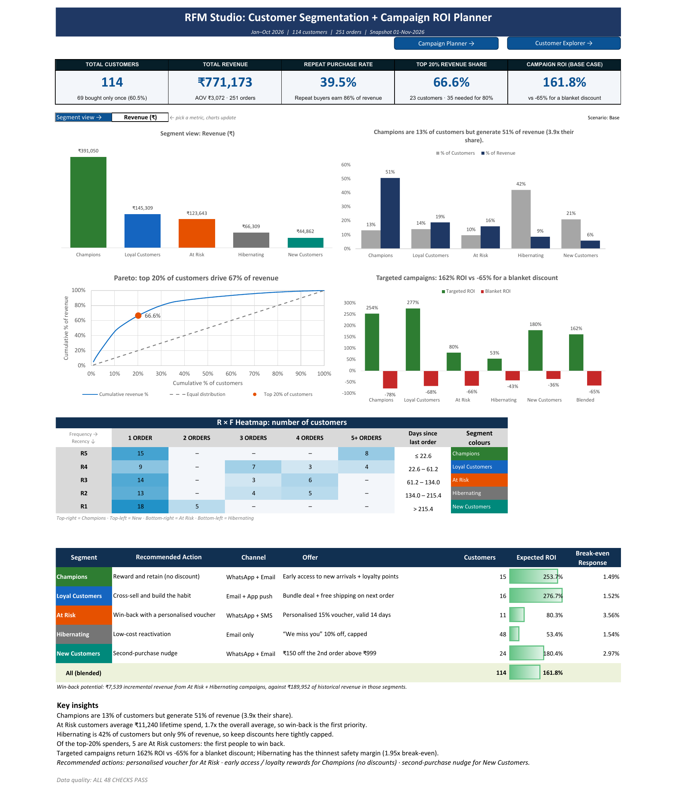
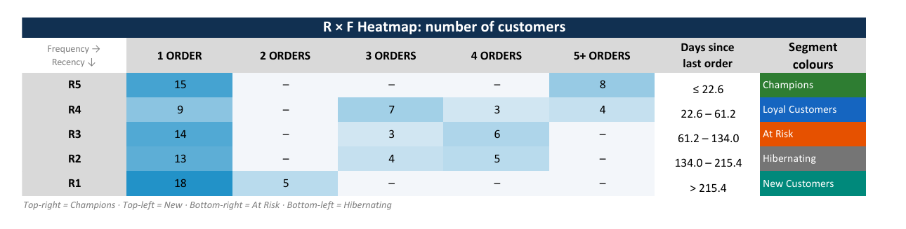
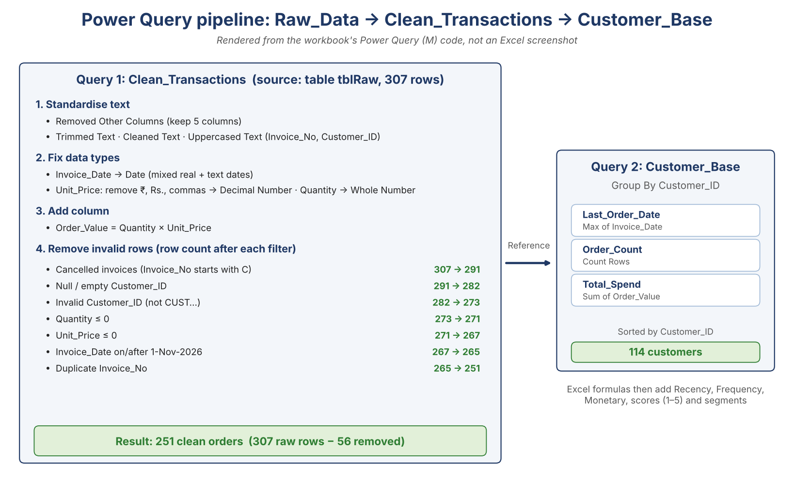

# RFM Studio: Customer Segmentation + Campaign ROI Planner

An Excel project that cleans messy transaction data with **Power Query**, scores customers with **RFM**, segments them, and compares **targeted campaigns against a blanket discount**, all in a self-validating dashboard.

> **Data note:** the dataset is simulated (307 raw rows, Jan to Oct 2026). Response rates, costs and the 35% margin are explicit assumptions, not real company figures.

## Business problem
The marketing team sends the same discount to everyone. Which customers should be retained, won back or rewarded, and what is the expected ROI of each campaign?

## Key results
| Metric | Result |
|---|---|
| Customers / clean orders / revenue | 114 / 251 / ₹771,173 |
| Repeat purchase rate | 39.5% |
| Champions | 13% of customers, 51% of revenue |
| Top 20% of customers | 66.6% of revenue (35 customers reach 80%) |
| Targeted campaigns, blended ROI (base case) | 161.8% |
| Blanket 20% discount (same assumptions) | −65.4% |
| Scenario range (worst to optimistic) | 5.0% to 263.5% |

## What is inside
- **Power Query:** trims and standardises IDs, fixes mixed dates and prices, removes 56 invalid rows (307 to 251), groups to 114 customers
- **RFM model:** COUNTIFS / SUMIFS / MAXIFS, percentile cut-offs, XLOOKUP scoring, IFS segmentation
- **Analysis:** segment summary, Pareto curve, R×F heatmap
- **Campaign planner:** ROI formula, Scenario Manager (4 scenarios), Goal Seek break-even response rates
- **Dashboard:** KPI cards, dropdown-driven chart, slicer-based customer explorer
- **QA:** 48 live checks in the Data_Log sheet (master status: ALL 48 CHECKS PASS)

## Screenshots

## How to use
1. Download `02_workbook/RFM_Studio_Final.xlsx` (Excel 2021 or later).
2. Open the **Dashboard**. Use the dropdown to switch the segment metric.
3. To refresh: paste new rows into the `Raw_Data` table, then **Data → Refresh All** (twice).
4. Change assumptions on the **Assumptions** sheet, or use **Data → What-If Analysis → Scenario Manager**.

## Limitations
- Simulated data; real response rates need an A/B test with a holdout group.
- Small segments (11 At Risk customers): expected-value ROI hides discrete outcomes.
- Ten months of data: seasonality and lifetime value are not modelled.
- The Power Query date filter (before 1-Nov-2026) is written into the query, not linked to the Assumptions sheet.

## Skills shown
Power Query · Excel formulas (XLOOKUP, IFS, SORTBY, SUMIFS, MAXIFS) · Pivot tables and slicers · Scenario Manager · Goal Seek · Dashboard design · Data validation and QA

## Author
Vipul Sharma · [LinkedIn](https://www.linkedin.com/in/vipul-sharma-lpu-alumnus/) · [GitHub](https://github.com/vipulsharma2108)
